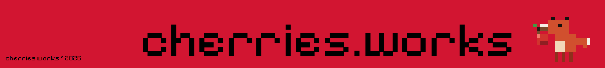

##cherries.works

Develops **open-source** software with a focus on Linux, systems programming, and lightweight developer tools.

The goal is to build software that is easy to understand, dependable in production, and free from unnecessary complexity.

Every project is designed around the same principles:

* Simplicity
* Performance
* Reliability
* Transparency
* Open source
